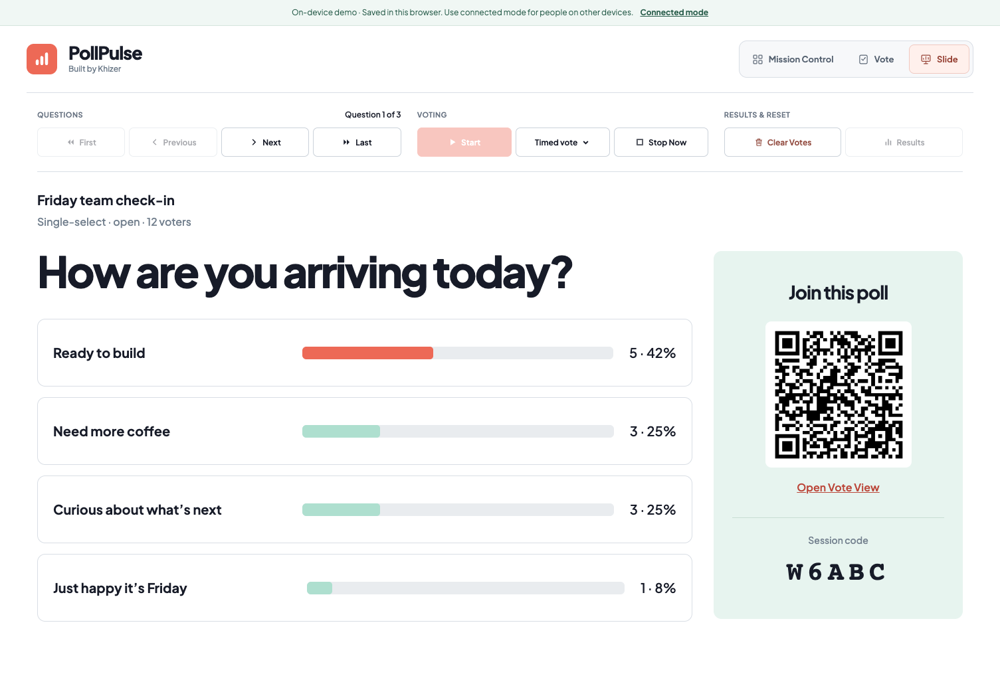
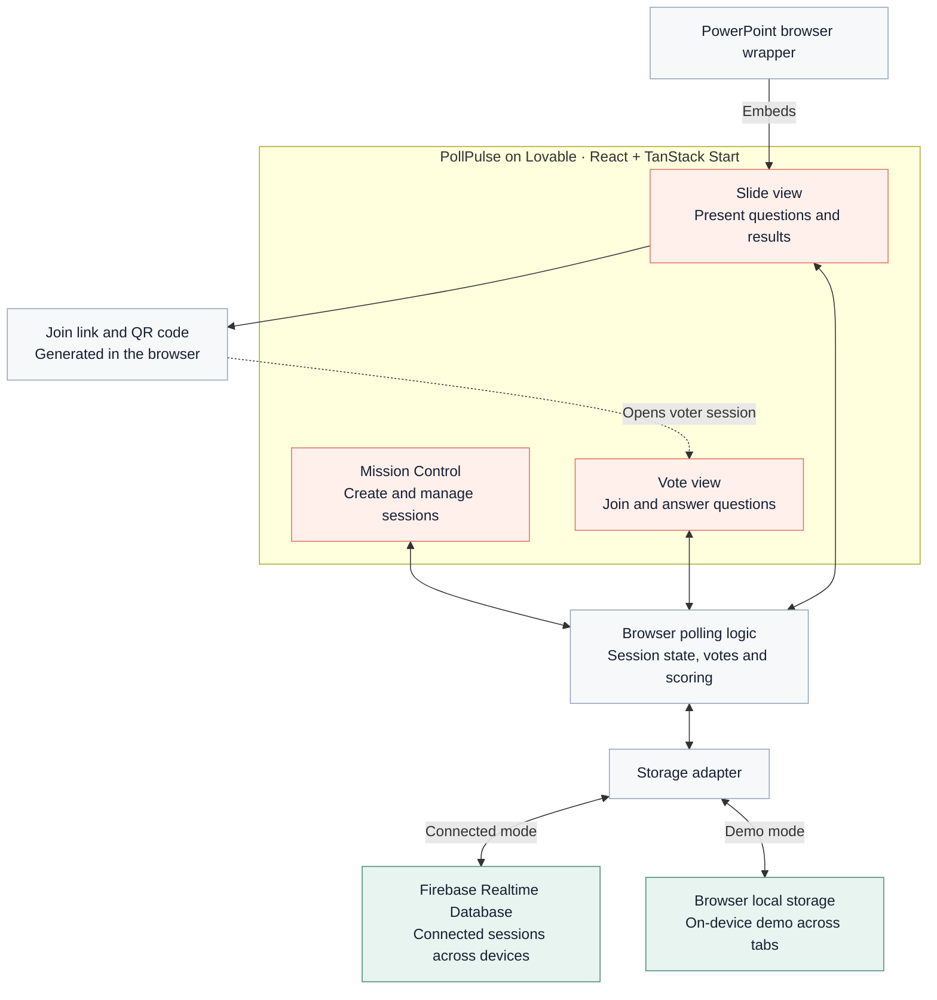

# PollPulse

**Make every answer feel personal.**

**[Open PollPulse](https://pollpulse-by-khiz.lovable.app)**

PollPulse turns a room into a live conversation. A host builds questions, people join with a name and a playful avatar, and the presenter reveals how the room answered. Opinion polls finish with small groups of people who think alike; quizzes finish with a shared-rank leaderboard.

Built by Khizer.

**Project status:** published on Lovable. Open the app to create a session or try the on-device demo.

This is the public documentation showcase. Application source and runtime configuration live in a separate private repository.

## The experience

1. **Build a session.** Create single-select or multi-select questions and optionally mark correct answers.
2. **Gather the room.** Share a voter link or QR code. Voters choose their name, glyph or initial, and avatar color.
3. **Run the poll.** Open voting, watch totals change, set a timer, and move through questions at your own pace.
4. **Reveal the room.** Close voting to show the people behind each answer, then reveal quiz results or opinion similarity groups.

## Architecture

Each view runs polling logic in the browser. Connected sessions synchronize through Firebase; the on-device demo uses separate local storage and works across tabs in the same browser. The presenter generates join QR codes locally, and the PowerPoint wrapper embeds the presenter view.

## Designed for the room and the phone

The presenter view keeps big questions, clear answer bars, and the join code in view. The voter view puts a single question within easy reach. Self-hosted Plus Jakarta Sans, white space, coral actions, and mint sharing panels give both views a shared visual language.

[Explore the features](docs/features.md) · [Read the design notes](docs/design.md) · [See the architecture](docs/architecture.md)

## Repository boundary

This repository contains documentation only. It does not contain runnable application code, credentials, backend project configuration, participant data, or deployment files. Screenshots, when present, use synthetic demonstration content.
