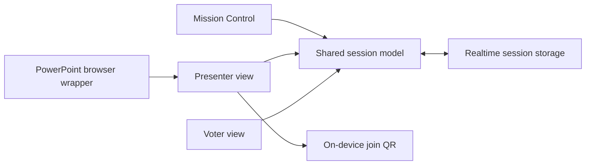

# Architecture

The rebuilt frontend uses React and TanStack Start through Lovable. It retains the original polling model, provides separate host, presenter, and voter routes, and synchronizes connected sessions through a realtime repository. An isolated browser-storage repository supports local preview.

The private application repository contains implementation and setup details. This public showcase describes the product and its design without exposing source or runtime configuration.
